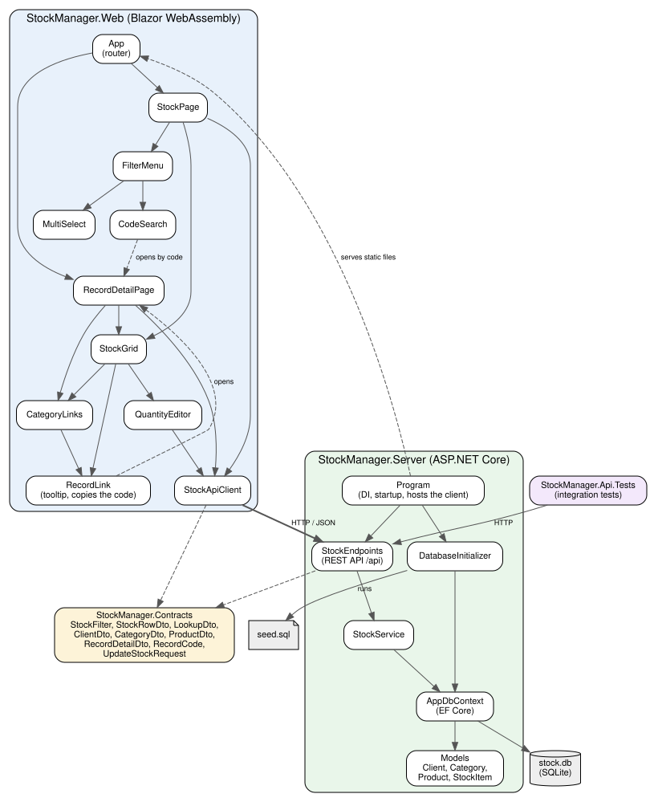

# Správa skladu

Webová aplikace v .NET 10 pro správu skladu produktů s jednou filtrovatelnou stránkou s gridem. Klient v Blazor WebAssembly čte a mění data přes REST API, data jsou v souboru SQLite a přistupuje se k nim přes EF Core. Zadání je v [docs/zadani.md](docs/zadani.md).

## Architektura



Diagram vytváří `dotnet build` z `docs/architecture.dot`, pokud je nainstalovaný Graphviz.

## Spuštění

Potřeba je jen .NET 10 SDK.

```bash
dotnet run --project src/StockManager.Server
```

Aplikace běží na `http://localhost:5080`. Při prvním spuštění vytvoří `src/StockManager.Server/stock.db` a naplní ji testovacími daty ze souboru [seed.sql](src/StockManager.Server/Data/seed.sql).

Existující databáze se znovu nenaplňuje, takže změny počtů kusů přežijí restart. Návrat k výchozím datům, například po úpravě souboru s daty:

```bash
dotnet run --project src/StockManager.Server -- --reset-db
```

Testy:

```bash
dotnet test
```

## Struktura

| Projekt | Obsah |
|---|---|
| `src/StockManager.Server` | REST API, EF Core a SQLite, naplnění databáze, hostování klienta |
| `src/StockManager.Web` | Blazor WebAssembly: stránka, filtr a grid |
| `src/StockManager.Contracts` | DTO sdílená serverem a klientem |
| `tests/StockManager.Api.Tests` | integrační testy API proti skutečnému SQLite souboru |

## REST API

| Metoda | Cesta | Popis |
|---|---|---|
| GET | `/api/clients`, `/api/categories`, `/api/products` | možnosti filtru |
| GET | `/api/stock?clientIds=1&categoryIds=2&productIds=3` | řádky gridu |
| PUT | `/api/stock/{clientId}/{productId}` | změna počtu kusů, tělo `{ "quantity": 5 }`, vrací 204, 400 nebo 404 |
| GET | `/api/clients/{code}`, `/api/categories/{code}`, `/api/products/{code}` | detail záznamu, vrací 200 nebo 404 |

## Rozhodnutí

- **Řádek gridu je dvojice klient a produkt.** Počet kusů patří k této dvojici, takže produkt ve více kategoriích má jeden řádek s kategoriemi vedle sebe a stejné množství se v gridu neopakuje.
- **Klient vidí produkt, pokud s ním sdílí aspoň jednu kategorii.** U řádku se ukazují jen tyto společné kategorie a jen podle nich funguje filtr kategorií.
- **Klienti, kategorie a produkty mají neměnný kód.** Kód vrací i seznamy `/api/clients`, `/api/categories` a `/api/products`, takže přejmenování nic nerozbije. Kód (`KLI_000001`, `KAT_000001`, `PROD_000001`) generuje databáze z id, které se nikdy nepoužije znovu, takže ho nejde změnit ani zduplikovat. Testovací data v `seed.sql` určují id a odkazují se na záznamy kódem. Vazby v databázi a filtr gridu používají interní id.
- **Detail a hledání podle kódu.** Každý klient, kategorie a produkt má stránku `/detail/{kód}`. Hledání ve filtru pozná typ záznamu podle předpony (`KLI_`, `KAT_`, `PROD_`) a detail otevře. Malá písmena a mezery okolo kódu nevadí. Detail otevře i kliknutí na klienta, kategorii nebo produkt v gridu a po najetí na odkaz se zobrazí kód s ikonou pro kopírování. Detail jen zobrazuje údaje a řádky skladu daného záznamu, měnit jde stejně jako v gridu jen počet kusů.
- **Počet kusů se ukládá tlačítkem nebo Enterem.** Tlačítko se zobrazí až po změně spolu s rozdílem, například `3 → 5`, takže šipky číselného pole neposílají požadavek při každém kroku.
- **Filtr:** hodnoty v jednom seznamu se kombinují přes OR, seznamy mezi sebou přes AND a prázdný seznam řádky neomezuje.
- **Blazor WebAssembly místo Blazor Server,** protože stránka má data získávat přes REST API.
- **Řazení probíhá v prohlížeči,** protože SQLite neřadí české znaky správně.
- **`EnsureCreated` místo migrací,** protože databáze je testovací a jde kdykoli znovu vytvořit.

## Nad rámec zadání

Zadání žádá jednu stránku s gridem. Záměrně navíc jsou kódy záznamů, stránka detailu a hledání podle kódu ve filtru.

## Vědomá zjednodušení

Aplikace nemá stránkování, přihlašování ani správu klientů, produktů a kategorií. Při souběžné úpravě stejného řádku platí poslední zápis.
